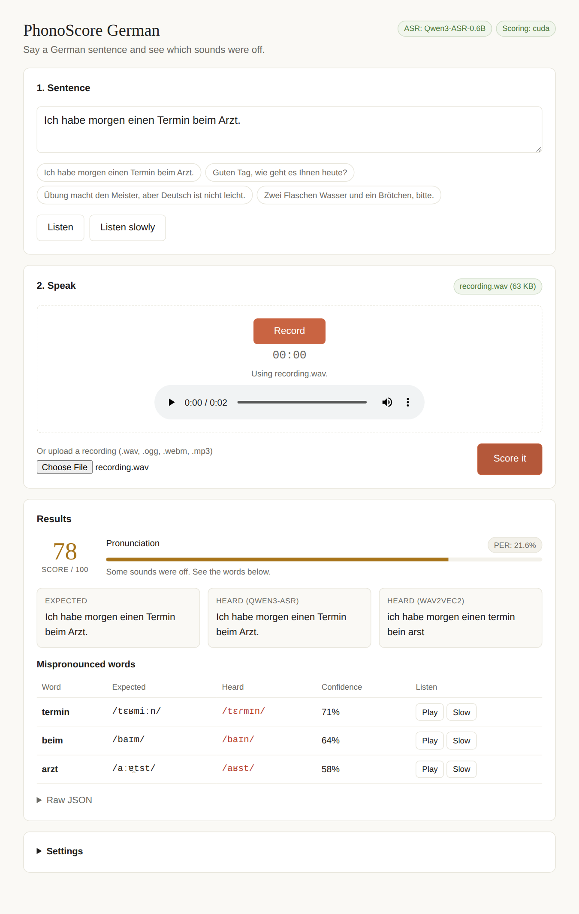

# PhonoScore German

Self-hosted **German pronunciation assessment**. Record a sentence and get a pronunciation score, the phoneme error rate, and each mispronounced word with expected vs. heard IPA. Includes a web app, a CLI and an HTTP API.

[](https://www.python.org/)
[](LICENSE)



## Features

- **Pronunciation score** (0–100) and **phoneme error rate** for any German sentence
- **Mispronunciation detection** per word: expected IPA, the IPA actually heard, and a confidence
- **Speech-to-text** with Qwen3-ASR (OpenAI-compatible endpoint), to show what the speaker said
- **Reference audio** (optional): hear the sentence or a single word, at normal or slow speed, via [Chatterbox TTS Server](https://github.com/devnen/Chatterbox-TTS-Server)
- Runs locally on NVIDIA GPU, Apple Silicon or CPU

## Quickstart

1. Install the system packages:

   ```bash
   # Debian / Ubuntu
   sudo apt install ffmpeg espeak-ng build-essential python3-dev
   # macOS
   brew install ffmpeg espeak-ng
   ```

2. Clone and start:

   ```bash
   git clone https://github.com/RefNull/phonoscore-german.git
   cd phonoscore-german
   python3 serve.py
   ```

   On first run, `serve.py` creates `.venv` and installs `requirements.txt`.

3. When the log says `Ready`, open **http://localhost:8002**.

The first assessment downloads the models (several GB) from Hugging Face, so it takes a few minutes. Later runs load them from the cache.

## Usage

### Web app

Open `http://<server>:8002`. Pick or type a sentence, press **Record**, read it aloud, then press **Score it**. You can also upload a recording.

Browsers only allow the microphone on `https://` or `localhost`. For a server on your network, either upload files or tunnel the port: `ssh -L 8002:localhost:8002 <server>`.

### CLI

```bash
.venv/bin/python cli.py --text "Ich habe morgen einen Termin beim Arzt."    # record from the microphone
.venv/bin/python cli.py --text "Guten Tag." --audio-file sample.wav          # score a file
```

| Flag | Default | |
|---|---|---|
| `--text` | `Ich habe morgen einen Termin beim Arzt.` | Sentence the speaker should say |
| `--audio-file` | | `.wav` or `.ogg` to score instead of recording |
| `--asr-url` | `http://localhost:8001` | ASR service |
| `--pronounce-url` | `http://localhost:8002` | Scoring service |
| `--router` | off | Send requests through llama-swap instead |
| `--router-url` | `http://localhost:8080` | llama-swap URL |
| `--samplerate` | `16000` | Microphone sample rate |

To record from the microphone, the CLI needs PortAudio (`sudo apt install libportaudio2` or `brew install portaudio`).

### HTTP API

```bash
# Score pronunciation
curl -F file=@recording.wav -F expected_text="Ich habe morgen einen Termin beim Arzt." \
     http://localhost:8002/assess

# Transcribe (OpenAI-compatible)
curl -F file=@recording.wav -F language=de http://localhost:8001/v1/audio/transcriptions
```

| Endpoint | Service | Form fields |
|---|---|---|
| `POST /assess` | scoring, port 8002 | `file` (.wav/.ogg), `expected_text`, `lang` (default `de`) |
| `POST /v1/audio/transcriptions` | ASR, port 8001 | `file`, `language` (default `de`), `model` (ignored) |
| `GET /health` | both | returns `status`, `service`, `device` (and `model` for ASR) |
| `GET /` | scoring, port 8002 | the web app |

`/assess` response:

```json
{
  "score": 82.5,
  "transcription": "ich habe morgen einen termin beim arzt",
  "phoneme_error_rate": 0.175,
  "errors": [
    { "word": "termin", "expected_ipa": "tɛʁˈmiːn", "actual_ipa": "tɛʁˈmɪn", "confidence": 0.65 }
  ]
}
```

| Field | |
|---|---|
| `score` | Pronunciation score, 0–100 |
| `transcription` | What the Wav2Vec2 acoustic model heard |
| `phoneme_error_rate` | Phoneme error rate; 0 is perfect |
| `errors[]` | Mispronounced words: `word`, `expected_ipa`, `actual_ipa`, `confidence` (0–1; `0` when OpenPronounce's phone recognizer is off) |

## Configuration

### serve.py

| Flag | Default | |
|---|---|---|
| `--model` | `Qwen3-ASR-0.6B` | ASR model, see below |
| `--device` | `auto` | `auto`, `cuda`, `mps` or `cpu` |
| `--host` | `0.0.0.0` | Bind address |
| `--asr-port` / `--pronounce-port` | `8001` / `8002` | Service ports |
| `-d`, `--detach` | | Run in the background |
| `--status` / `--stop` | | Check or stop a background run |
| `-f`, `--logs` | | Follow the log (`logs/serve.log`; per service in `logs/asr.log`, `logs/pronounce.log`) |
| `--python` / `--no-auto-setup` | | Use a specific interpreter / don't create `.venv` |

You can also run the services separately: `python asr_server.py --port 8001` and `python pronounce_server.py --port 8002`. Both take `--host` and `--device`.

### ASR model

| `--model` | Hugging Face repo | |
|---|---|---|
| `Qwen3-ASR-0.6B` (default) | `Qwen/Qwen3-ASR-0.6B-hf` | Fast, small VRAM footprint |
| `Qwen3-ASR-1.7B` | `Qwen/Qwen3-ASR-1.7B-hf` | More accurate |
| any other value | a repo ID or local path | Must be a Qwen3-ASR `-hf` checkpoint |

Set it with `--model` or the `PHONOSCORE_ASR_MODEL` environment variable. Weights go to the Hugging Face cache (`~/.cache/huggingface`, or wherever `HF_HOME` points). To run offline, pass a local path and set `HF_HUB_OFFLINE=1`.

### llama-swap

To load models on demand, run llama-swap from this directory with `.venv` activated, using the included [`llama-swap.yaml`](llama-swap.yaml):

```bash
llama-swap --config llama-swap.yaml --port 8080
.venv/bin/python cli.py --router
```

In the web app, choose **llama-swap** under Settings. See the [llama-swap README](https://github.com/mostlygeek/llama-swap) for how it works.

## How it works

- **Scoring:** [OpenPronounce](https://github.com/Halleck45/OpenPronounce) turns the expected sentence into German IPA with espeak-ng and recognizes the phones actually spoken with Wav2Vec2. It aligns the two and flags substitutions, deletions and insertions.
- **Transcription:** [Qwen3-ASR](https://github.com/QwenLM/Qwen3-ASR) transcribes the same recording, so you see what was said.
- The two services are independent. The client calls both.

## Language support

PhonoScore supports German only for now. These parts are German-specific:

- The default language `de` in `asr_server.py`, `pronounce_server.py`, `cli.py` and `client.html`
- The OpenPronounce models and espeak-ng voice chosen for `de`
- The sample sentences and German TTS voice in `client.html`, and the default sentence in `cli.py`

## Development

```bash
pip install -r requirements-dev.txt
pytest
```

The tests run offline with mocks. No GPU or model download is needed.

## License

[MIT](LICENSE). For third-party software and models, see [THIRD_PARTY_LICENSES.md](THIRD_PARTY_LICENSES.md).
